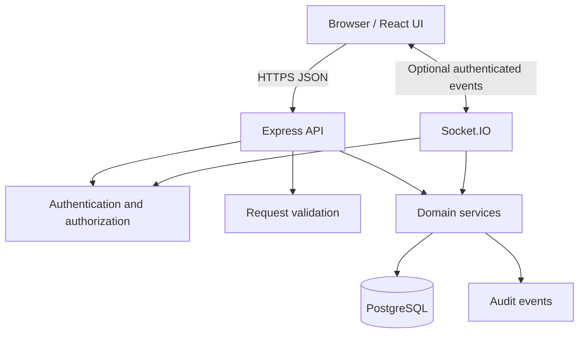

# System Architecture

## 1. Architecture decision

Use a **modular monolith**: one frontend, one Express API, and one PostgreSQL database. Separate domain modules in code, but avoid the operational complexity of microservices for a one-week portfolio build.

## 2. Context diagram



## 3. Request flow

1. Browser sends a request over HTTPS.
2. Middleware applies request IDs, security headers, rate limits, and authentication where required.
3. Validation parses untrusted input.
4. Authorization checks team membership and resource permissions.
5. Controller calls a domain service.
6. Service applies business rules and performs database operations.
7. Server returns a documented response.
8. UI updates state and presents feedback.

## 4. Trust boundaries

- Browser input is untrusted, including IDs, roles, votes, and submitted totals.
- Database data is not executable instructions.
- Public share routes are unauthenticated and return only a sanitized response.
- Socket events must independently authorize each room and action.
- Submitted URLs must not be fetched by the server.

## 5. Backend layers

### Routes
Declare HTTP method/path and attach authentication, authorization, validation, and rate-limit middleware.

### Controllers
Translate validated HTTP input into service calls and HTTP responses. Avoid complex business logic.

### Services
Implement domain rules, transactions, and multi-record workflows. Keep them testable without HTTP.

### Repositories (optional)
Encapsulate parameterized database queries where this improves clarity.

### Validators
Define schemas for request params, query strings, and bodies.

Do not create layers that only forward calls without improving maintainability.

## 6. Repository layout

```text
group-project-court/
├── client/
│   └── src/
│       ├── app/
│       ├── components/
│       ├── features/
│       │   ├── auth/
│       │   ├── teams/
│       │   ├── tasks/
│       │   ├── cases/
│       │   └── voting/
│       ├── lib/
│       ├── routes/
│       └── styles/
├── server/
│   └── src/
│       ├── config/
│       ├── middleware/
│       ├── routes/
│       ├── controllers/
│       ├── services/
│       ├── repositories/
│       ├── validators/
│       ├── sockets/
│       ├── utils/
│       ├── app.js
│       └── server.js
├── database/
│   ├── migrations/
│   └── seeds/
├── docs/
└── README.md
```

## 7. Verdict workflow

1. Verify the requester can close the case.
2. Begin a database transaction and lock the case row or use an equivalent concurrency-safe strategy.
3. Confirm the case is open.
4. Aggregate eligible votes.
5. Apply the documented verdict rule and tie policy.
6. Persist the verdict, tally, and rule version.
7. Record an audit event.
8. Commit the transaction.
9. Repeated close requests return the existing result.

## 8. Key trade-offs

- PostgreSQL provides relational integrity and transactional voting.
- Deterministic verdicts are easier to explain and test than AI decisions.
- Realtime is optional because correctness must not depend on Socket.IO.
- Private-by-default cases reduce accidental exposure.
